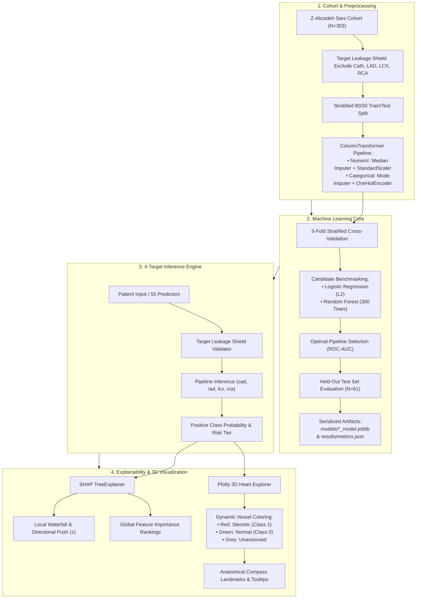

# CardioVision3D — Cardiovascular Risk Intelligence & 3D Anatomical Explorer

*Tagline: See the Risk. Understand the Heart.*

---

## 1. Executive Summary & Clinical Problem

Coronary Artery Disease (CAD) remains the single largest cause of cardiovascular mortality worldwide. While invasive catheter angiography is the gold-standard diagnostic modality, early non-invasive triage is essential for identifying high-risk candidates and assessing localized epicardial arterial stenosis prior to catheterization.

Existing machine learning healthcare applications frequently present predictions as disconnected "black-box" risk scores. Clinicians and researchers require:
1. **Global Disease Presence:** Is significant obstructive coronary disease present?
2. **Arterial Specificity:** Which specific epicardial vessels—**LAD**, **LCX**, or **RCA**—exhibit stenosis?
3. **Multimodal Reasoning:** Which patient-specific biomarkers, clinical signs, and ECG waveforms drive the prediction?
4. **Anatomical Context:** Where are these stenotic vessels situated relative to ventricular myocardium?

**CardioVision3D** addresses this need by combining:
- A high-performance ensemble of four specialized binary classifiers.
- Local and global **SHAP (SHapley Additive exPlanations)** directional feature attributions.
- A real-time, interactive **3D coronary vessel explorer** in Plotly projecting predictions directly onto cardiac anatomy.
- An enterprise-grade clinical decision-support interface built with Streamlit.

> [!WARNING]
> **Clinical Safety Notice:**  
> CardioVision3D is an experimental research and educational decision-support platform. It is not clinically validated for diagnostic use. Predictions are generated from machine learning models on a clinical cohort and must not replace individualized clinical judgment. Consult a qualified cardiologist or healthcare professional for medical diagnosis.

---

## 2. Intended Users & Clinical Scope

- **Cardiovascular Specialists & Researchers:** Exploring non-invasive multivariable prediction models across tabular clinical biomarkers (demographics, 12-lead ECG, blood biochemistry, echocardiography).
- **Medical Informatics Researchers:** Investigating explainable AI (XAI) and 3D visual correlation for clinical decision support.
- **Cardiology Trainees & Students:** Studying coronary anatomy, myocardial perfusion territories, and predictive biomarker interactions.

---

## 3. System Architecture

The following diagram illustrates the complete data processing, machine learning pipeline, inference engine, and interactive visualization architecture:



---

## 4. Cohort Profile & Preprocessing

The platform utilizes the **Z-Alizadeh Sani Cardiovascular Cohort** (`Sheet 1 - Table 1` in `data/raw/extention of Z-Alizadeh sani dataset.xlsx`), containing **303 patient records** and **59 total fields**.

### Predictor Modalities (55 Features)
- **Demographics & Vitals:** Age, Weight, Length, Sex, BMI, Blood Pressure (BP), Pulse Rate (PR).
- **Medical History & Comorbidities:** Diabetes Mellitus (DM), Hypertension (HTN), Current Smoker, EX-Smoker, Family History (FH), Obesity, Chronic Renal Failure (CRF), Cerebrovascular Accident (CVA), Airway disease, Thyroid Disease, Congestive Heart Failure (CHF), Dyslipidemia (DLP), Weak Peripheral Pulse.
- **Symptoms & Physical Exam:** Typical Chest Pain, NYHA Function Class, Lung rales, Systolic Murmur, Diastolic Murmur, Dyspnea, Atypical Chest Pain, Nonanginal Pain, Exertional CP, LowTH Ang.
- **12-Lead Electrocardiography (ECG):** Q Wave, ST Elevation, ST Depression, T-wave Inversion, Left Ventricular Hypertrophy (LVH), Poor R Progression, Bundle Branch Block (BBB).
- **Biochemistry & Hematology:** Fasting Blood Sugar (FBS), Creatinine (CR), Triglycerides (TG), LDL, HDL, Blood Urea Nitrogen (BUN), ESR, Hemoglobin (HB), Potassium (K), Sodium (Na), White Blood Cell count (WBC), Lymphocytes, Neutrophils, Platelets (PLT).
- **Echocardiography:** Ejection Fraction (EF-TTE), Regional Wall Motion Abnormality (Region RWMA), Valvular Heart Disease (VHD).

### Diagnostic Targets & Class Definitions
Four clinical outcomes confirmed by catheterization:
1. **Cath (`cad`):** `CAD` (Class 1) vs `Normal` (Class 0).
2. **LAD (`lad`):** `Stenotic` (Class 1) vs `Normal` (Class 0).
3. **LCX (`lcx`):** `Stenotic` (Class 1) vs `Normal` (Class 0).
4. **RCA (`rca`):** `Stenotic` (Class 1) vs `Normal` (Class 0).

### Leakage Prevention
- Diagnostic outcome columns (`Cath`, `LAD`, `LCX`, `RCA`) are strictly excluded from predictor matrices.
- Preprocessing imputers, scalers, and encoders are fit strictly on training folds (`X_train`) and applied downstream.
- The prediction module rejects any input payload containing target columns with an immediate `ValueError`.

---

## 5. Model Performance & Validation Results

Models were tuned via 5-fold cross-validation on 80% training data and evaluated on an **untouched, stratified 20% held-out test cohort (N=61)**.

### Held-Out Test Evaluation Summary (`results/metrics.json`)

| Target | Selected Model | 5-Fold CV ROC-AUC | Test Accuracy | Test Precision | Test Recall | Test F1-Score | Test ROC-AUC | Test N (Pos / Neg) |
| :--- | :--- | :---: | :---: | :---: | :---: | :---: | :---: | :---: |
| **Cath (CAD)** | Random Forest | 0.918 ± 0.040 | **85.2%** | **88.6%** | **90.7%** | **0.897** | **0.870** | 61 (43 / 18) |
| **LAD Stenosis** | Random Forest | 0.836 ± 0.038 | **77.0%** | **78.9%** | **83.3%** | **0.811** | **0.836** | 61 (36 / 25) |
| **LCX Stenosis** | Random Forest | 0.709 ± 0.046 | **62.3%** | **52.6%** | **50.0%** | **0.511** | **0.700** | 61 (20 / 41) |
| **RCA Stenosis** | Random Forest | 0.781 ± 0.065 | **68.9%** | **60.0%** | **52.2%** | **0.558** | **0.730** | 61 (23 / 38) |

---

## 6. Interactive 3D Coronary Explorer

The 3D visualization engine in `src/visualization.py` maps machine learning predictions directly onto the coronary arterial tree using Plotly:
- **Myocardial Ventricular Mesh:** Parametric 3D cardiac volume with anatomical apex tapering and aortic root base.
- **Coronary Arteries:**
  - **LAD (Left Anterior Descending):** Anterior interventricular groove to the apex.
  - **LCX (Left Circumflex):** Left atrioventricular groove into the posterior lateral wall.
  - **RCA (Right Coronary Artery):** Right atrioventricular groove towards the inferior base.
- **Dynamic Status Legend:**
  - 🔴 **Red (`#ef4444`):** Predicted Stenosis (Class 1).
  - 🟢 **Green (`#10b981`):** Predicted Normal (Class 0).
  - ⚪ **Grey (`#64748b`):** Unassessed / Baseline.
- **Interactive Tooltips:** Real-time hover inspection detailing anatomical territory, vessel significance, and model probability.

---

## 7. Explainable AI (SHAP)

The XAI engine in `src/explain.py` applies **SHAP TreeExplainer**:
- **Patient-Specific Directional Push:** Pinpoints features increasing risk (e.g., elevated Triglycerides, typical angina) vs. protective indicators (e.g., normal FBS, younger age).
- **Clinical Feature Mapping:** Pipeline tokens are translated into clear clinical names and units.
- **Global Feature Importance:** Ranks top predictors across the cohort.

---

## 8. Technology Stack

- **Runtime:** Python 3.11+
- **Application Framework:** Streamlit 1.65+
- **Machine Learning:** Scikit-Learn 1.9+, Joblib 1.6+
- **Explainability:** SHAP 0.51+, Numba 0.68+
- **3D Visualization:** Plotly 7.1+, Matplotlib 3.11+
- **Data Processing:** Pandas 3.0+, NumPy 2.4+, OpenPyXL 3.1+
- **Testing:** Pytest 9.1+

---

## 9. Repository Structure

```text
CardioVision3D_ML_Starter/
├── app.py                      # Multi-section clinical web application
├── requirements.txt            # Python dependencies
├── README.md                   # System documentation
├── src/
│   ├── config.py               # Path definitions, clinical metadata, target labels
│   ├── preprocessing.py        # Leakage-safe column transformers, imputation, scaling
│   ├── train.py                # 5-fold CV model selection & test set serialization
│   ├── predict.py              # Cached 4-target inference engine
│   ├── explain.py              # SHAP TreeExplainer local & global feature attributions
│   ├── visualization.py        # Interactive 3D Plotly heart & coronary tree schematic
│   └── evaluate.py             # Held-out test metrics summary generator
├── data/
│   └── raw/
│       └── extention of Z-Alizadeh sani dataset.xlsx   # Clinical cohort dataset
├── models/
│   ├── cad_model.joblib        # Serialized pipeline for overall CAD (Cath)
│   ├── lad_model.joblib        # Serialized pipeline for LAD stenosis
│   ├── lcx_model.joblib        # Serialized pipeline for LCX stenosis
│   └── rca_model.joblib        # Serialized pipeline for RCA stenosis
├── results/
│   └── metrics.json            # Measured test evaluation metrics
└── tests/
    ├── test_preprocessing_and_data.py   # Dataset & leakage prevention tests
    ├── test_models_and_predict.py       # Inference structure & validation tests
    ├── test_visualization.py            # 3D figure generation & trace tests
    ├── test_explain.py                  # SHAP attribution & feature name tests
    └── test_metrics.py                  # Metrics serialization integrity tests
```

---

## 10. Installation & Setup (Windows PowerShell)

```powershell
# 1. Activate virtual environment
.\.venv\Scripts\Activate.ps1

# 2. Upgrade pip & install dependencies
python -m pip install --upgrade pip
python -m pip install -r requirements.txt

# 3. Run automated tests (18 tests)
python -m pytest tests -v

# 4. Launch CardioVision3D platform
python -m streamlit run app.py
```
*Access the platform at `http://localhost:8501`.*

---

## 11. Automated Test Suite

```powershell
python -m pytest tests -v
```

18 automated unit and integration tests verify:
- ✅ Dataset loading & sheet schema
- ✅ Leakage shield validation
- ✅ All four model artifacts loading
- ✅ Inference schema & positive-class probability indexing
- ✅ 3D Plotly figure generation and trace dynamics
- ✅ SHAP TreeExplainer local attributions & global feature importance
- ✅ Metrics JSON integrity & summary table generation

---

## 12. Attribution & Ethics

- **Dataset Attribution:** Alizadeh Sani et al., *A data mining approach for diagnosis of coronary artery disease*, Computer Methods and Programs in Biomedicine, 2013.
- **Privacy & Security:** Local offline execution; zero patient health data transmitted to external services.
- **Clinical Notice:** Experimental decision-support platform only; not a substitute for clinical diagnosis.
